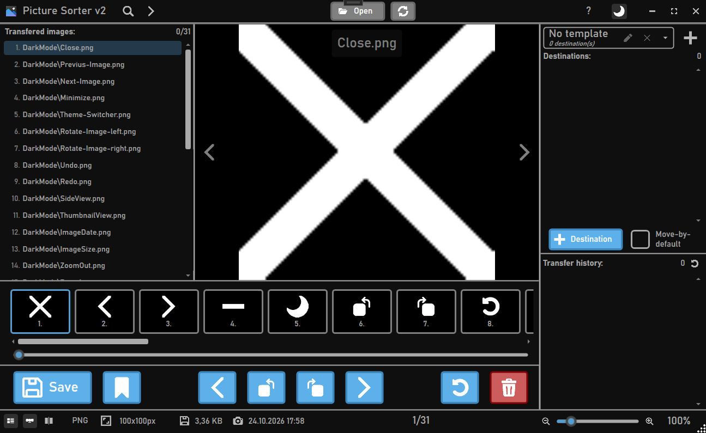

# Picture Sorter

A modern windows application based on .NET 10.0 and WPF that allows you to view, check and sort your pictures into pre-defined folders (destinations).

*Uses [LinkingMountainsImageZoomWPF](https://github.com/BRIZEIUM/LinkingMountainsImageZoomWPF) to display images which is licensed under the MIT license.*

## Features

- Light and Dark mode
- Image zoom and rotation
- Split view
- Search capabilities
- Recursive image loading
- Undo capabilities
- Link raw files
- Destination templates
- Handles 10.000+ pictures simultaneously
- Keyboard shortcuts support

---

### File type compatibility

At the time only these picture types are supported and can be loaded and viewed properly
- .jpg
- .jpeg
- .png
- .bmp
- .tiff

---

### Raw file support

Automatically recognized image raw file types:
- .arw (Sony)
- .cr2 (Canon)
- .cr3 (Canon)
- .nef (Nikon)
- .nrw (Nikon)
- .raf (Fujifilm)
- .rw2 (Panasonic/Lumix)
- .rwl (Leica)
- .3fr (Hasselblad)
- .fff (Hasselblad)
- .dng (Universal)

---
> [!CAUTION]
> ### Image deletion warning
> 
> When using the move image to trash feature on files that are located on a network drive, the images will be deleted permanantly or handled by the remote drive (e.g. if using a NAS). Be careful!
